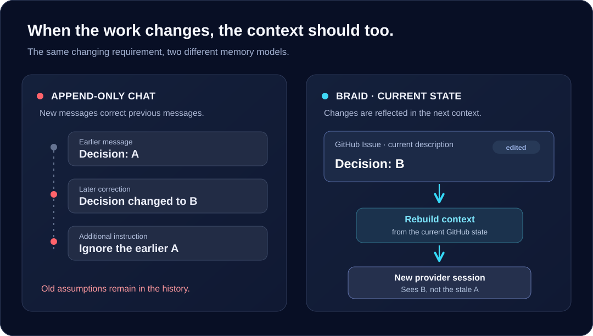

<p align="center">
  
</p>

<h1 align="center">Braid</h1>

<p align="center">
  <strong>Context that follows the work, not the chat history.</strong>
</p>

<p align="center">
  Braid gives local coding agents a different way to work on long-running software tasks:<br>
  build their context from the <em>current</em> state of Issues and pull requests on GitHub or the built-in platform,<br>
  instead of treating an ever-growing conversation as the project's memory.
</p>

<p align="center">
  <a href="#why-braid">Why Braid</a> ·
  <a href="#how-it-works">How it works</a> ·
  <a href="#get-started">Get started</a> ·
  <a href="#documentation">Documentation</a>
</p>

## Why Braid

A software task does not evolve like a chat transcript. Requirements are rewritten. Decisions are reversed. Reviews are resolved. Work continues across days, people, and agent sessions.

A conventional, append-only agent conversation can retain both an old decision and the correction that superseded it. Compacting that transcript may reduce its size, but compaction alone does not establish which GitHub facts are currently authoritative.

**Braid makes the current collaboration state the starting point for context.**



When an Issue changes from decision **A** to **B**, a new Braid context reflects the current Issue description and visible discussion. Material changes to facts already in an agent's context can invalidate the old provider session, so subsequent work need not carry the superseded text forward.

GitHub retains its normal history; **Braid changes what enters the agent's working context**.

## How it works

Braid connects a local coding agent to the collaboration surfaces developers already use:

1. **Discuss in Issues.** An Issue holds the current problem, design, relevant metadata, and visible discussion. An Issue agent can participate and maintain that shared working state.
2. **Implement in pull requests.** An implementation request can create a draft PR and a dedicated Git worktree. The PR agent works from the current PR and its associated Issues, rather than a frozen copy of the original request.
3. **Rebuild when the work changes.** GitHub events bring changes to Braid's attention. Braid reads canonical GitHub state to build context; material edits can trigger session replacement while the task's code workspace remains available.

The model has three deliberately different parts:

| | Responsibility |
| --- | --- |
| **GitHub or built-in platform** | Shared, editable working memory: current requirements, decisions, discussion, and relationships. |
| **Git worktree** | Durable task-local code and working files, preserved across compatible provider-session replacements. |
| **Provider session** | Replaceable execution context used by the coding agent, not the authority for the task. |

Braid is a local Rust application. It connects to GitHub through a GitHub App or to the built-in collaboration platform through its object API, and supports coding-agent providers through runtime adapters. It does not require a hosted Braid service.

## Get started

The current packaged installation targets **macOS on Apple Silicon**. You'll need authenticated [GitHub CLI (`gh`)](https://cli.github.com/), a repository where you can install a GitHub App, and credentials for your selected coding-agent provider. See the [setup guide](docs/user-manual/setup.md) for full prerequisites and Codex/Pi configuration.

**1. Install Braid**

```sh
brew install xiaoland/braid/braid
```

**2. Set up your GitHub App and agent**

For example, using Pi with a DeepSeek API key available as `DEEPSEEK_API_KEY`:

```sh
braid setup owner/repository --provider pi --model deepseek-chat --api-key-environment DEEPSEEK_API_KEY
```

Follow the printed GitHub App installation link, then check the instance and start the local runtime:

```sh
braid doctor --instance owner
braid serve --instance owner --tunnel
```

The instance key defaults to the repository owner; replace `owner` with your chosen key if you configured one. `--tunnel` exposes the local webhook endpoint through a supervised temporary tunnel.

**3. Start from a GitHub Issue**

A repository maintainer can activate Braid by posting a visible, trusted `@braid` mention in an Issue. Ordinary GitHub Apps cannot be selected as native Issue assignees; assignment requires a separately provisioned GitHub Agent App. The [setup guide](docs/user-manual/setup.md#activating-braid-on-an-issue) explains this distinction.

> [!NOTE]
> Braid is an early-stage, local-first project. Review the [supported scope](docs/10-prd/scope.md) and [deployment guide](docs/40-deployment/README.md) before relying on it for unattended work.

## 内建协作平台

内建平台与 GitHub 是 Harness 的两种上游。平台独立持有仓库、Issue、PR、讨论
和事件；Harness 单独接入并执行 Agent，不以 `local` 运行模式拥有协作对象。
Web Console 属于整个 Braid，平台配置与 Harness 配置可分别装配。

先声明平台，再声明 Harness；[内建平台指南](docs/user-manual/local.md)包含启动、
对象操作、候选发布和旧 Local 数据迁移。

```shell
braid platform init --source /absolute/path/to/repository --config /absolute/path/to/platform.toml --name demo
braid init --source /absolute/path/to/repository --config /absolute/path/to/harness/config.toml --name demo --endpoint http://127.0.0.1:18082 --adapter pi --executable /absolute/path/to/pi --provider deepseek --model deepseek-chat --api-key-environment DEEPSEEK_API_KEY
braid migrate apply --config /absolute/path/to/harness/config.toml
braid console --platform-config /absolute/path/to/platform.toml --config /absolute/path/to/harness/config.toml --database /absolute/path/to/observations.sqlite3
```

## 本地 Web Console

内置 Console 接收 OTLP HTTP/protobuf，持久保存 traces、logs、metrics 的原始证据，
并提供浏览器可视化。Console 接入平台对象 API 和统一 Harness 控制接口，支持
GitHub 或内建上游，不经 CLI 子进程；停止 Harness 后 Collector 和平台仍可使用。操作方法和数据边界见[Console 指南](docs/user-manual/console.md)。

## Design boundaries

- **Current state over transcript history.** Braid deterministically projects the GitHub objects that matter to a task; it does not ask another model to invent a replacement summary.
- **Events are signals, not truth.** A webhook tells Braid that something changed. The authoritative content comes from GitHub's current state.
- **Changes can remove stale context.** Editing or removing material already projected into a session can cause Braid to rebuild context and replace that session.
- **Agents can update their own working memory.** Useful design decisions belong in Issue/PR descriptions and concise discussion; every internal turn need not become a public comment.
- **Incomplete context is visible.** When the complete context cannot be made available, Braid does not silently truncate it and send an apparently complete view to the agent.

## Documentation

| Start here | For |
| --- | --- |
| [Setup guide](docs/user-manual/setup.md) | GitHub App bootstrap, provider credentials, activation, and local runtime. |
| [Built-in platform](docs/user-manual/local.md) | Platform and Harness setup, objects, candidate publication, and migration. |
| [Web Console](docs/user-manual/console.md) | OTLP collection, visualization, and Harness control for either upstream. |
| [Product model](docs/10-prd/README.md) | Purpose, working memory, Issue/PR collaboration, and current product scope. |
| [Context design](docs/20-product-tdd/context.md) | Current-state projection, revisions, invalidation, and replacement. |
| [Runtime lifecycle](docs/20-product-tdd/lifecycle.md) | Events, scheduling, sessions, and recoverability. |
| [Deployment & observability](docs/40-deployment/README.md) | Configuration, migrations, diagnostics, and operations. |
| [Real end-to-end acceptance](docs/10-prd/acceptance.md) | How the complete GitHub-to-agent workflow is verified. |

For source development, Braid is a single Rust package that produces a portable `braid` executable. Build with `cargo build --locked`; the repository's product and technical contracts live in [`docs/`](docs/10-prd/README.md). See the [MIT license](LICENSE).


Braid 使用编译、实际操作及获授权实验取得反馈，不维护或运行测试代码、模拟提供方、包 smoke 或自检入口。GitHub、provider 和 OTel 原始证据及人工判断构成产品验收依据。
